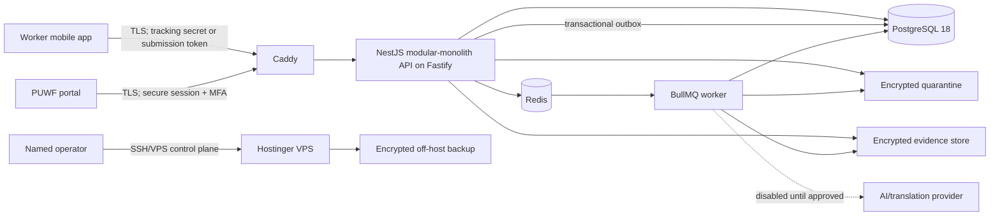

# Architecture and Contract Baseline

## System context and trust boundaries

Trust boundaries are: public internet to Caddy; Caddy to private containers; application to database/Redis/filesystem; worker to optional external providers; operators to VPS/secrets/backups. PostgreSQL, Redis and storage directories are not publicly exposed. The portal never reads evidence paths directly.

## Deployment units and module boundaries

- `apps/api`: one NestJS/Fastify HTTP process, versioned REST/OpenAPI, auth, authorization, rate limits and orchestration.
- `apps/worker`: separate process using the same framework-free application/domain services for scan, AI, notifications, outbox dispatch and retention work.
- PostgreSQL 18: authoritative business/audit/outbox state.
- Redis + BullMQ: transient dispatch and coordination; never the only durable record of business intent.
- Local encrypted filesystem: separate quarantine, accepted evidence, temporary export and backup-staging roots; IDs in the database, never client-visible paths.
- Caddy: TLS termination, security headers, request/body limits and routing.

The modular monolith owns modules for identity/access, complaints, uploads/evidence, case management, worker tracking/feedback, audit, analytics/exports and operations. Cross-module writes go through application services and database transactions, not direct controller-to-table coupling.

## Existing service-to-production mapping

| Current contract | Production owner |
|---|---|
| `complaintService` | Complaint intake and worker projection API |
| `offlineQueueService` | Mobile durable outbox plus idempotent submission/upload protocol |
| `caseManagementService` | Staff case command/query endpoints with optimistic concurrency |
| `caseLifecycleService` | Server-side domain policy reused by API and worker |
| `priorityRulesService` | Deterministic server priority floor; AI may only suggest |
| `evidenceService` | Upload authorization, quarantine, scan and encrypted object lifecycle |
| `analyticsService` | Server-side aggregate queries and controlled export jobs |
| `locationService` | Versioned location reference data |
| `rightsContentService` | Versioned, reviewed public rights content |
| `demoService` | Non-production fixture adapter only; prohibited from production composition root |

## API-wide conventions

- Base path `/api/v1`; JSON UTF-8; OpenAPI is generated and checked into CI as an artifact.
- UUID/ULID internal IDs. Human references and tracking secrets are separate server-generated values.
- `Idempotency-Key` required for complaint creation, upload finalization, feedback and staff commands with external effects.
- Mutation responses include resource `version`; staff commands use `If-Match` or expected version and return `409 CONFLICT` on stale state.
- Times are RFC 3339 UTC; display timezone is a client concern. Pagination is opaque cursor based.
- Errors use `{ error: { code, message, requestId, details? } }`; details never expose secrets, paths, raw provider responses or stack traces.
- Every request receives a correlation ID. Audit events identify actor, action, target, outcome and purpose without copying sensitive payloads.

## Operation inventory

| Operation | Actor/auth | Input/output | Idempotency and audit | Sensitive/data owner |
|---|---|---|---|---|
| `POST /complaints/submissions` | Worker; short-lived submission token or anonymous session | Validated intake intent → reference, one-time tracking secret, authoritative status/version | Required; audit consent/privacy choice and outcome | Highly sensitive; complaint owner |
| `GET /complaints/submissions/:key` | Same submission context | Recovery of committed result after timeout | Key lookup; access event | Confidential |
| `POST /uploads` | Worker submission token | Declared type/size/checksum → upload ID/tus URL | Required; audit allocation | Highly sensitive; evidence owner |
| `HEAD/PATCH /uploads/:id` | Bound upload credential | tus offset negotiation/chunks | Protocol offset is replay-safe; chunk metadata logged | Highly sensitive |
| `POST /uploads/:id/finalize` | Bound upload credential | Checksum/metadata → processing status | Required; audit finalize | Highly sensitive |
| `GET /uploads/:id/status` | Bound worker/staff context | quarantine/scan readiness projection | Read audit for staff | Sensitive |
| `POST /tracking/session` | Worker reference + tracking secret | Rotating, limited tracking session | Rate limited; failed/success audit without secret | Confidential |
| `GET /tracking/cases/:reference` | Tracking session | Worker-safe case projection only | Read/access audit | Confidential |
| `POST /tracking/cases/:reference/feedback` | Tracking session | Outcome/comment → accepted/version | Required; audit and possible reopen command | Confidential |
| `POST /auth/login` | Named staff account | Identifier/password → pending MFA/session | Rate limited; all outcomes audited | Credential data; identity owner |
| `POST /auth/mfa/verify` | Pending staff session | TOTP/recovery code → authenticated session | Replay prevention; audit | Secret/auth data |
| `POST /auth/logout` | Staff session | Session invalidation | Safe retry; audit | Internal |
| `GET /staff/cases` | Staff session + `case.read` | Filters/cursor → redacted summaries | Query audit at aggregate level | Confidential |
| `GET /staff/cases/:id` | Staff session + case scope | Role/redaction-aware case | Sensitive reveal separately audited | Highly sensitive |
| `POST /staff/cases/:id/commands` | Staff permission + expected version | Typed command → new version/projection | Required; append audit/history/outbox atomically | Confidential/highly sensitive |
| `POST /staff/cases/:id/identity-reveal` | Step-up permission and purpose | Purpose → minimal identity view | Never cached; mandatory audit | Highly sensitive |
| `GET /staff/evidence/:id/content` | Scoped evidence permission | Stream/range response | Every access audited; no path exposure | Highly sensitive |
| `GET /staff/analytics` | `analytics.read` | Bounded filters → suppressed aggregates | Query policy audit | Aggregated confidential |
| `POST /staff/exports` | `export.create` + step-up | Bounded export definition → job ID | Required; approval/audit/outbox | Highly sensitive |
| `GET /staff/exports/:id` | Creator/approver permission | State or expiring download | Download audited | Highly sensitive |
| `GET /health/live` | Internal/public minimal | Process liveness | No sensitive detail | Public |
| `GET /health/ready` | Internal monitor | Dependency readiness | No credentials/topology detail | Internal |

## Error catalogue

`VALIDATION_FAILED` 400, `AUTHENTICATION_REQUIRED` 401, `INVALID_CREDENTIALS` 401, `MFA_REQUIRED` 403, `FORBIDDEN` 403, `NOT_FOUND` 404, `CONFLICT` 409, `INVALID_TRANSITION` 409, `IDEMPOTENCY_CONFLICT` 409, `UPLOAD_OFFSET_CONFLICT` 409, `PAYLOAD_TOO_LARGE` 413, `UNSUPPORTED_MEDIA_TYPE` 415, `RATE_LIMITED` 429, `MALWARE_DETECTED` 422, `PROVIDER_UNAVAILABLE` 503 and `INTERNAL_ERROR` 500. Client messages are localization keys or safe generic text; the request ID links to internal diagnostics.

